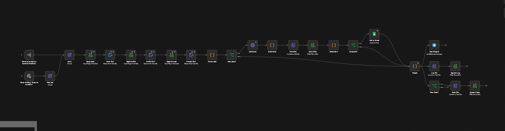
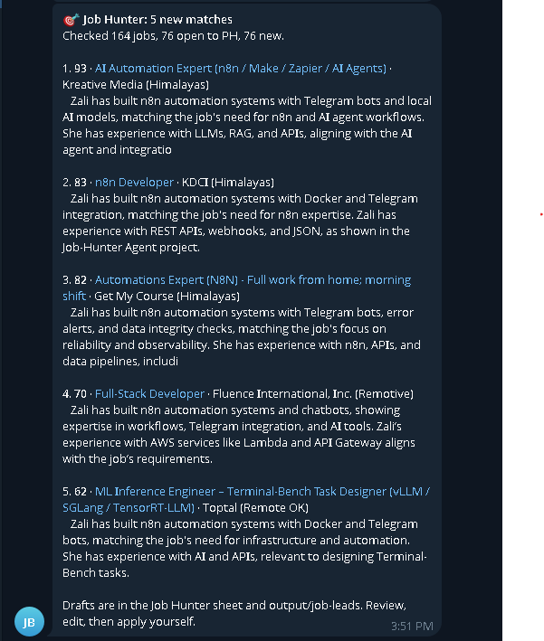
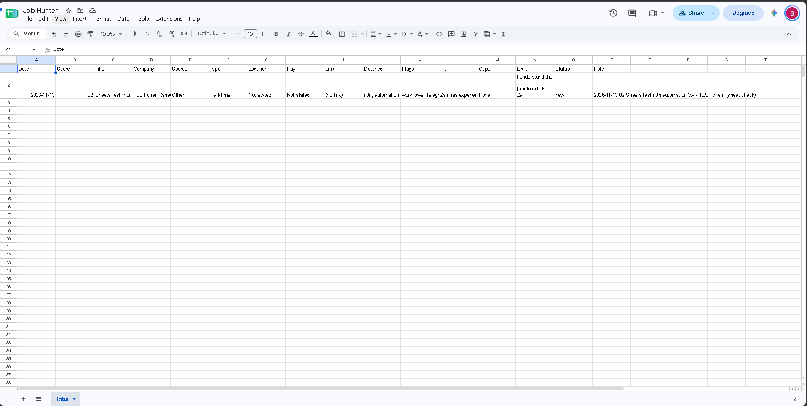
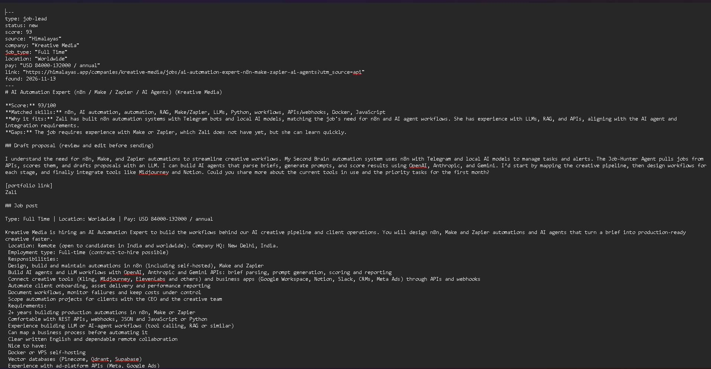

# Job Hunter Agent

An n8n agent that finds part-time remote AI automation jobs, scores them against my skills, and drafts a tailored proposal for each good match. I review every draft and send it myself. **It never applies on its own.**

Built with n8n (self-hosted in Docker), a local LLM (qwen3:8b via Ollama), Google Sheets and Telegram.


<!-- screenshot placeholder: the "Job Hunter - Process" workflow in the n8n editor -->

---

## Problem

Finding freelance automation work as a beginner takes hours a day:

- Jobs are spread across many sites, and most posts don't fit (senior roles, US-only, wrong skills).
- Each good post needs a tailored reply. Generic copy-paste proposals get ignored.
- Many clients hide screening instructions in the post ("start your reply with the word BLUE"). Miss one and you're out.
- The biggest Philippine job sites (OnlineJobs.ph, Facebook groups) **don't allow bots**, and Upwork shut down its RSS feeds in 2024. Scraping them would break their terms.

## Solution

```
 Official job APIs ──┐                                       ┌──> Telegram digest (phone)
 (Himalayas, Remote OK,│   Score with code   Draft with      ├──> Google Sheet (tracking)
  Jobicy, Remotive)    ├─> (0-100, rules) ─> local LLM ──────┤
 Paste form ──────────┘   filter + dedupe    (qwen3:8b)      └──> Markdown note per job
 (OnlineJobs.ph, Upwork,
  FB groups: by hand)
```

1. **Legal sources only.** Every source was checked for terms and API access before use ([docs/sources.md](docs/sources.md)). Sites that forbid bots go through a 30-second paste form instead.
2. **Code scores, the AI writes.** The score (0 to 100) comes from clear rules: skills matched (n8n, AI automation, RAG, Python...), job type, whether the Philippines can apply, seniority, scam signs. Same job, same score, every time, and you can see why. The 8B model only writes the "why it fits" line and the draft.
3. **Guardrails a small model can't forget.** Code finds screening instructions in the post and makes sure the draft follows them, signs it with my name, and adds my portfolio link. The prompt also forbids inventing experience: the model may only use facts from [profile/skills-profile.md](profile/skills-profile.md).
4. **Human in the loop.** Drafts land in a sheet and as notes with `status: new`. I edit and send them myself.
5. **Runs on a laptop that sleeps.** The daily workflow checks at 9 AM, 12 PM, 3 PM and 6 PM and only fetches once per day. Errors go to Telegram.

### The 4 workflows

| Workflow | What it does |
|---|---|
| `Job Hunter - Daily` | Pulls jobs from 4 official APIs once a day, normalizes them into one format, sends them to Process |
| `Job Hunter - Paste` | A form at `localhost:5680/form/job-paste` for jobs I found on sites that don't allow bots |
| `Job Hunter - Process` | Dedupe, score, draft with qwen3, save note + sheet row, Telegram digest, run log |
| `Job Hunter - Error Alert` | Sends a Telegram message if any of the above fails |

## Result

First live run (2026-11-12):

- **162** jobs fetched from 4 APIs, **77** open to applicants in the Philippines, **5** drafts written, in **36 seconds**.
- A pasted OnlineJobs.ph-style post was scored **91/100** and drafted in **16 seconds**. The post said "start your application with the word AUTOMATE", and the draft did.
- Cost: **$0**. Everything runs locally except the free job APIs, Telegram and Google Sheets.


<!-- screenshot placeholder: the daily digest on the phone -->


<!-- screenshot placeholder: the Jobs sheet with scores and drafts -->


<!-- screenshot placeholder: one job note with score, gaps and draft -->

**Honest limits:** an 8B local model writes decent but sometimes generic drafts, so every draft needs a human edit. The free APIs lean toward full-time developer jobs; most part-time VA gigs still come in through the paste form.

---

## Setup

You need: Docker Desktop, [Ollama](https://ollama.com) with `ollama pull qwen3:8b`, a Telegram account, and a Google account. About 30 minutes.

1. **Clone and configure**
   ```bash
   git clone <this repo> job-hunter && cd job-hunter
   cp .env.example .env
   ```
   Put your Telegram user ID in `.env` (get it from @userinfobot). The Sheet ID comes in step 5.

2. **Start n8n**
   ```bash
   docker compose up -d
   ```
   Open http://localhost:5680 and create the owner account.

3. **Telegram bot:** message @BotFather, send `/newbot`, copy the token, then press **Start** in your new bot. In n8n: Credentials → Create → Telegram API → paste the token.

4. **Import the workflows**
   ```bash
   bash scripts/import-workflows.sh
   ```
   Then open `Job Hunter - Process` and `Job Hunter - Error Alert` and select your credentials in the nodes with a red warning.

5. **Google Sheets (optional):** create a sheet with a tab named `Jobs` and this first row:
   `Date, Score, Title, Company, Source, Type, Location, Pay, Link, Matched, Flags, Fit, Gaps, Draft, Status, Note`.
   Create a Google Cloud service account with the Sheets API enabled. Add it in n8n as **Google Service Account API**, share the sheet with its email as Editor, put the Sheet ID in `.env`, then run `docker compose up -d` again. Without a Sheet ID the agent skips this step.

6. **Make it yours:** edit [profile/skills-profile.md](profile/skills-profile.md) (only true facts) and, if you like, the scoring settings at the top of the `Score Jobs` node.

7. **Test:** open http://localhost:5680/form/job-paste and paste any job post. You should get a Telegram message within a minute.

### Project layout

```
docker-compose.yml       its own n8n, port 5680, reads .env
profile/                 skills profile the AI may use (read-only for n8n)
prompts/                 proposal prompt (read-only for n8n)
workflows/               the 4 n8n workflows, credential IDs replaced by placeholders
scripts/                 import, export and sanitize helpers
output/                  job notes, seen list, run log (gitignored)
docs/                    job source research, demo script, screenshots
```

After changing a workflow in the editor, run `bash scripts/export-workflows.sh` to save clean copies to `workflows/`.

## Job sources and terms

| Source | How | Why |
|---|---|---|
| Himalayas, Remote OK, Jobicy, Remotive | Official public APIs, once a day, with links back | Their terms allow it, with attribution and rate limits |
| OnlineJobs.ph | Paste form | Terms section 7.4 forbids automated access |
| Upwork | Paste form | RSS shut down 2024-08-20; the API needs an approved key |
| Facebook groups | Paste form | Groups API removed in 2024, scraping is against Meta's terms |

Full notes and links: [docs/sources.md](docs/sources.md).

## Built by

Zali, a 3rd-year IT student from the Philippines who builds n8n and AI automations. Open to part-time and freelance work.
